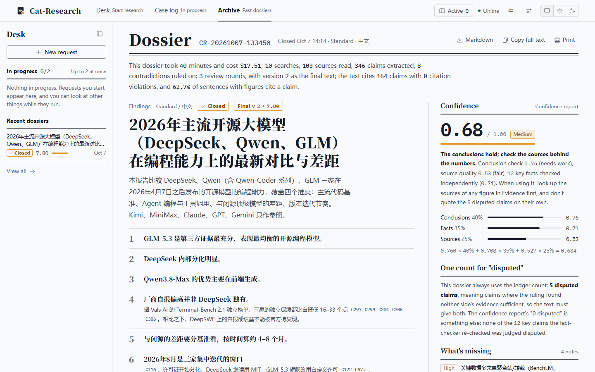
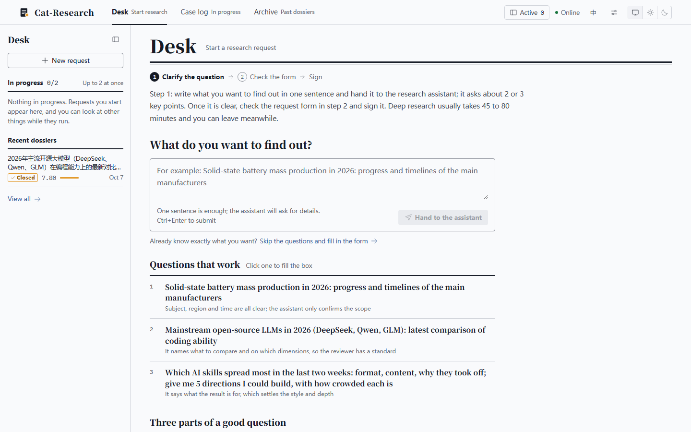
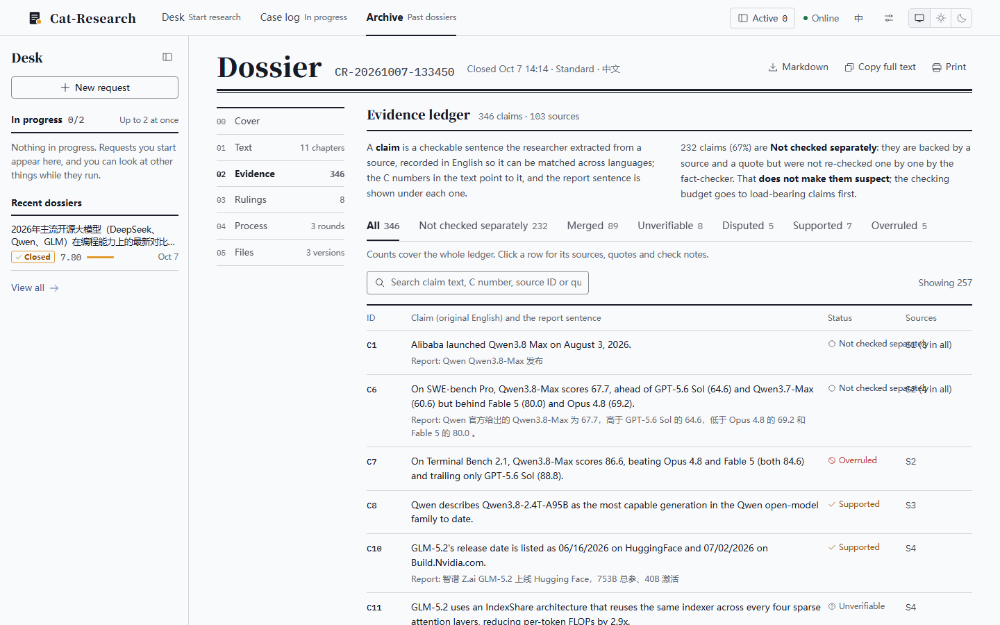
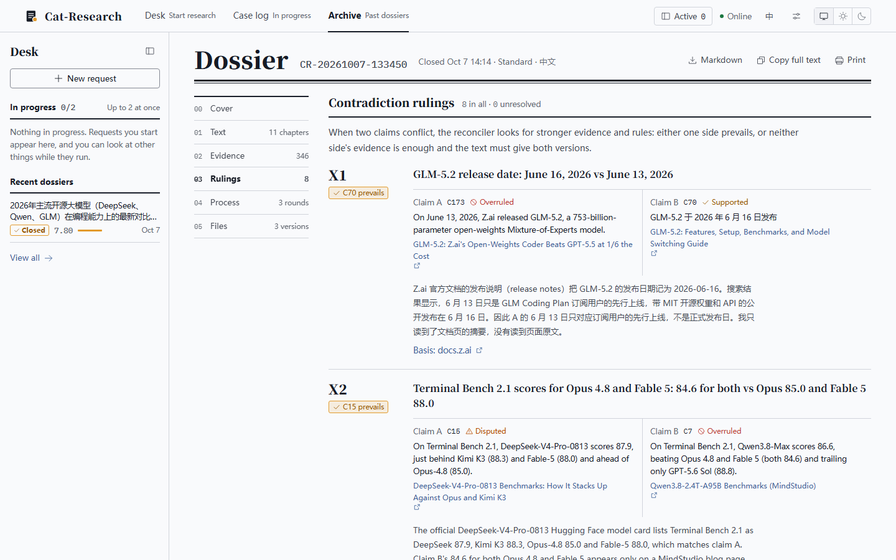

<div align="center">

# 🐱 Cat-Research

**A multi-agent deep research system: it searches, reconciles, fact-checks and iterates, then delivers a report where every claim traces back to a source**

[](https://python.org)
[](https://fastapi.tiangolo.com)
[](LICENSE)
[](https://github.com/anthropics/claude-agent-sdk-python)

[中文](README.md) · English

</div>



Cat-Research hands a research question to 10 agents with distinct jobs. It first asks what you actually need, then plans searches, browses the web, breaks what it reads into numbered claims and reconciles them, rules on contradictions with fresh searches, writes a draft and revises it over several review rounds, and finally delivers the final report plus a confidence report.

By default it calls Claude through the Claude Code CLI you are logged into on your machine (your subscription; no API key needed). OpenAI, Zhipu, and any OpenAI-compatible endpoint (DeepSeek, Kimi, Qwen, self-hosted and so on) are also supported, with Zhipu, Bocha or Tavily as the web search service.

## How it differs from a plain AI answer

- **Clarifies before it starts**: the research assistant asks 2–3 key questions (subject and time span, what you will use it for, depth) and turns the answers into a request form. Research starts only after you confirm it.
- **Claim ledger**: every source the researcher reads is broken into numbered claims (`C12`) with a quote from the original. The program checks the numbers and dates in each quote, merges duplicates (including the same claim stated in Chinese and English), and finds pairs of claims that contradict each other.
- **Contradictions ruled one by one**: the fact-checker searches independently to rule on each contradiction — one side wins, or neither side has enough evidence — and independently verifies key numeric claims.
- **The report must cite the ledger**: facts are cited as `[C<number>]`, and the program checks every paragraph. A draft that cites an overturned or unruled claim cannot become the final report.
- **Source tiers**: Tier 1–4 plus a 0–100 domain score; low-credibility sources are flagged and checked first.
- **Review and revise**: the critic scores 7 dimensions and the conclusion validator scores 5, both against your request. Revisions build on the best draft so far (a ratchet), with extra research when a review asks for it.
- **Step in mid-run**: pause, resume, stop, or add a requirement; it reaches every agent that works after it.
- **A dossier you can audit**: findings, full text, evidence, rulings, the score trail and every draft can be browsed and downloaded in the UI, along with token usage.

## Quick start

### Requirements

- Python 3.10+
- Node.js (to build the web UI; CI uses 22)
- [Claude Code](https://github.com/anthropics/claude-code) installed and logged in (not needed for other providers)
- Internet access (for live search)

### 1. Install

```bash
git clone https://github.com/mmlong818/Cat-Research.git
cd Cat-Research
pip install -r requirements.txt

# Build the web UI (output goes to static/, which is not in the repo)
cd frontend && npm ci && npm run build && cd ..
```

### 2. Log in to Claude Code

All agents call the local Claude Code through [claude-agent-sdk](https://github.com/anthropics/claude-agent-sdk-python) and reuse its login.

```bash
npm install -g @anthropic-ai/claude-code
claude auth login
```

> **Windows**: the SDK cannot call the `claude.CMD` that npm installs, so the program falls back to
> `node_modules/@anthropic-ai/claude-code/bin/claude.exe` inside the package. If it cannot find it, point `CLAUDE_CLI_PATH` at that file.

### 3. Run

```bash
python run_api.py
# open http://localhost:8000
```

It listens on localhost only by default. For LAN access see [Configuration](docs/configuration.en.md#lan-access).

## Usage

### Web UI



| Page | Path | What it does |
|------|------|--------------|
| **Desk** | `/new` | Say in one sentence what you want to find out; after the assistant's questions it drafts a request form. Check depth, report language (Chinese / English), provider and model, then sign it |
| **Case log** | `/case/{task id}` | Live timeline; pause / resume / stop; add requirements mid-run; at checkpoints in the revision loop a sign-off sheet asks whether to revise once more (continues automatically after 5 minutes without an answer) |
| **Archive** | `/cabinet` | Past research, filterable; resume from a checkpoint, rerun from a chosen phase, delete |
| **Dossier** | `/dossier/{session id}` | Six tabs: cover (findings and confidence), text, evidence (claim ledger), rulings (contradictions), process (score trail), files (download every draft) |

Up to 2 research runs at once. The UI switches between Chinese and English and supports light / dark / system themes.





### Depth

| Depth | Searches | Review rounds | Extra research (max) | Claims verified | Load-bearing re-checks | Typical time |
|-------|----------|---------------|----------------------|-----------------|------------------------|--------------|
| Quick `quick` | 6 | 1 | 0 | 8 | 0 | about a quarter of an hour |
| Standard `standard` (default) | 10 | 2–3 | 2 | 12 | 3 | about 40 minutes |
| Deep `deep` | 15 | 2–5 | 3 | 16 | 5 | 45–80 minutes |

You can also pick "custom rounds": searches as in Standard, with your own minimum and maximum number of revision rounds.


### Command line

```bash
# Research directly (Standard depth, no clarification, one confirmation before it starts)
python main.py "Global solid-state battery mass production progress and timelines of major makers in 2026"

# Interactive: after the question, up to 4 rounds of clarification (press Enter to skip), then confirm
python main.py
```

## Models and providers

By default every call goes through `claude-agent-sdk` to the local Claude Code:

| Role | Default model | Agents |
|------|---------------|--------|
| Core | `claude-opus-5-5` | Clarifier, Planner, Researcher, Analyst, Writer |
| Support | `claude-sonnet-5-5` | Critic, SourceVerifier, Reconciler, FactChecker, ConclusionValidator |

Other providers work too; the call layer routes by model ID:

| Provider | Core / support (default) | Web access | Structured output | API key |
|----------|--------------------------|------------|-------------------|---------|
| Claude | `claude-opus-5-5` / `claude-sonnet-5-5` | Claude Code's built-in WebSearch / WebFetch | SDK structured output + local validation | not needed |
| OpenAI | `gpt-6.1-sol` / `gpt-6-luna` | hosted web_search | json_schema (strict) + local validation | `OPENAI_API_KEY` |
| Zhipu | `glm-5.3` / `glm-5.3-flash` | local tool loop (selected search service + local page fetching) | json_object + prompt + local validation | `ZHIPU_API_KEY` |
| OpenAI-compatible | your own, recorded as `compat:<model name>` | local tool loop (selected search service + local page fetching) | json_object (falls back to the prompt when unsupported) + local validation | `COMPAT_API_KEY` |

- **In the UI**: in Settings, choose the default provider and its core and support models, and enter API keys (stored in the system credential store; the page shows only the last 4 characters). When signing a request you can switch provider or pick a specific model for that run; the choice is recorded in the audit log. Without the needed key the API returns 400 before creating the task. Replays keep the session's original provider and models.
- **OpenAI-compatible endpoint**: in Settings, fill in the base URL, API key and the core and support model names, then click "Test connection" to confirm it connects and the model supports tool calling (function calling); models without it cannot be used for research.
- **With environment variables or `settings.json`**: `CORE_MODEL` / `SUPPORT_MODEL` (take precedence), or copy `settings.example.json` to `settings.json` and fill in `core_model` / `support_model`.

### Web search

Claude and OpenAI use their own web access; Zhipu and the OpenAI-compatible endpoint use the search service chosen in Settings (page content is always fetched locally):

| Search service | API key | Notes |
|----------------|---------|-------|
| Zhipu Search API (default) | same as the Zhipu API key | |
| Bocha | `BOCHA_API_KEY` | reachable directly from mainland China |
| Tavily | `TAVILY_API_KEY` | free monthly credits; may need a proxy from mainland China |

## How it works

```
Question
   │
   ├─→ [1] 🗣️ Clarifier        Asks the key questions, drafts the request form (subject, scope, purpose, depth)
   ├─→ [2] 📋 Planner          Writes multilingual search queries (count set by depth)
   ├─→ [3] 🔍 Researcher       Searches and fetches in groups of 3, up to 4 groups in parallel; writes notes and structured claims (into the ledger)
   ├─→ [4] 🔎 SourceVerifier   Grades sources (Tier 1–4 + 0–100); extra research when sources are poor
   ├─→ [5] 📒 Reconciler       Merges duplicate claims, finds contradicting pairs
   │       🔬 FactChecker      Rules on each contradiction, independently verifies key claims
   ├─→ [6] 🧐 Analyst          Analysis based on the ruled ledger
   ├─→ [7] ✍️ Writer           First draft, citing the ledger as [C<number>]
   └─→ [8] 🔄 Revision loop (rounds set by depth)
           ├─ 📎 Citation check       Rebuilds the "claim sources" appendix, flags overturned / unruled citations
           ├─ 🎯 Critic               7 scores (out of 10), checked against the request
           ├─ ✔️ ConclusionValidator  5 scores, checked against the request
           ├─ 🏁 Stop check           see below
           ├─ 🔍 Extra research       when a review asks for it and budget remains; new claims are reconciled and ruled at once
           ├─ 🔬 Load-bearing checks  the most-cited, not-yet-checked claims in the best draft
           └─ ✍️ Writer               revises the best draft using review and validation feedback
   │
   ▼
Final report (09_final.md, the best draft without citation violations) + confidence report
```

**Stop conditions** (all require the minimum number of rounds first): review ≥ 8.0, conclusion validation ≥ 7.5, no citation violations and no unresolved contradictions; or one round in a row without beating the best review score; or the maximum number of rounds.

**Confidence** = conclusion validity × 40% + factual accuracy × 35% + source quality × 25% (missing parts are dropped and the rest renormalized); ≥ 0.75 is high, ≥ 0.55 medium, otherwise low.

### The 10 agents

| Agent | Job |
|-------|-----|
| 🗣️ **Clarifier** | Works out intent, asks the key questions, sets direction and depth |
| 📋 **Planner** | Breaks the question into multilingual search queries, layered by recency and domain |
| 🔍 **Researcher** | Searches and fetches pages with the provider's own web access (or the selected search service), gathers sources, extracts claims with quotes |
| 🔎 **SourceVerifier** | Gives each source a tier and a 0–100 score, flags unreliable sources |
| 📒 **Reconciler** | Compares new and old claims, merges duplicates, finds contradicting pairs |
| 🔬 **FactChecker** | Rules on each contradiction with its own searches, verifies key numeric claims, gives a 0.0–1.0 confidence |
| 🧐 **Analyst** | Pulls the material together into key findings: causes, trends, comparisons |
| ✍️ **Writer** | Writes the structured report; when revising, review feedback leads and validation feedback supplements |
| 🎯 **Critic** | Scores completeness, accuracy, depth, clarity, usefulness, sources and concision, and checks the request and mid-run requirements are met |
| ✔️ **ConclusionValidator** | Checks the conclusions for rigor, coverage and practical value, and whether they answer the request |

## Documentation

| Document | Contents |
|----------|----------|
| [Configuration](docs/configuration.en.md) | Environment variables, LAN access, security, research parameters |
| [API](docs/api.en.md) | Every endpoint: research tasks, sessions, clarification, settings |
| [Output](docs/output.en.md) | What each run's session folder contains |
| [Development](docs/development.en.md) | Dev mode, lint and tests, regression evaluation, project layout |

## License

[GNU GPL v3](LICENSE). You are free to use, modify and distribute it, commercially or not; if you distribute a modified version or a work based on it, you must release it under GPL v3 as well, with its source code.

Copyright (C) 2026 mmlong818
