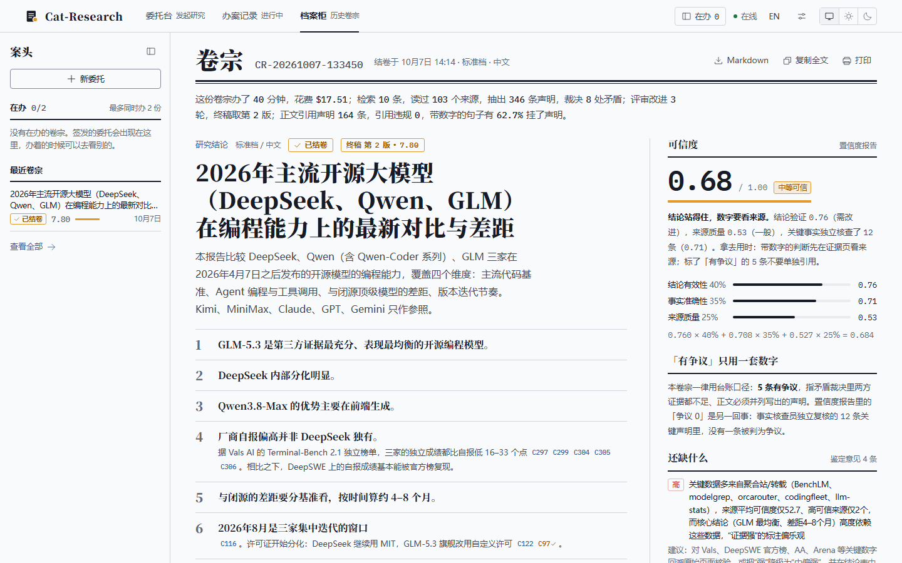
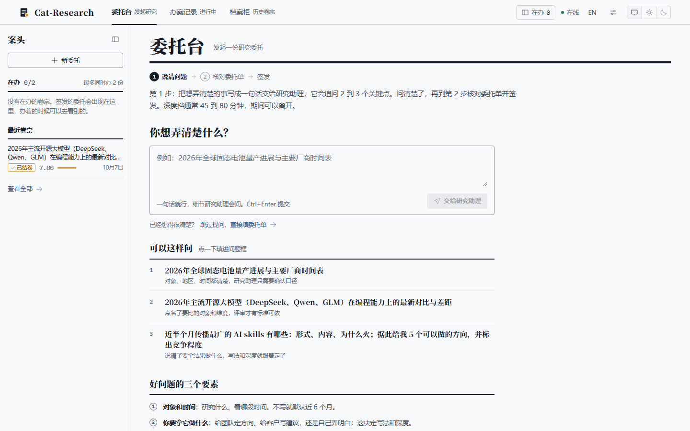
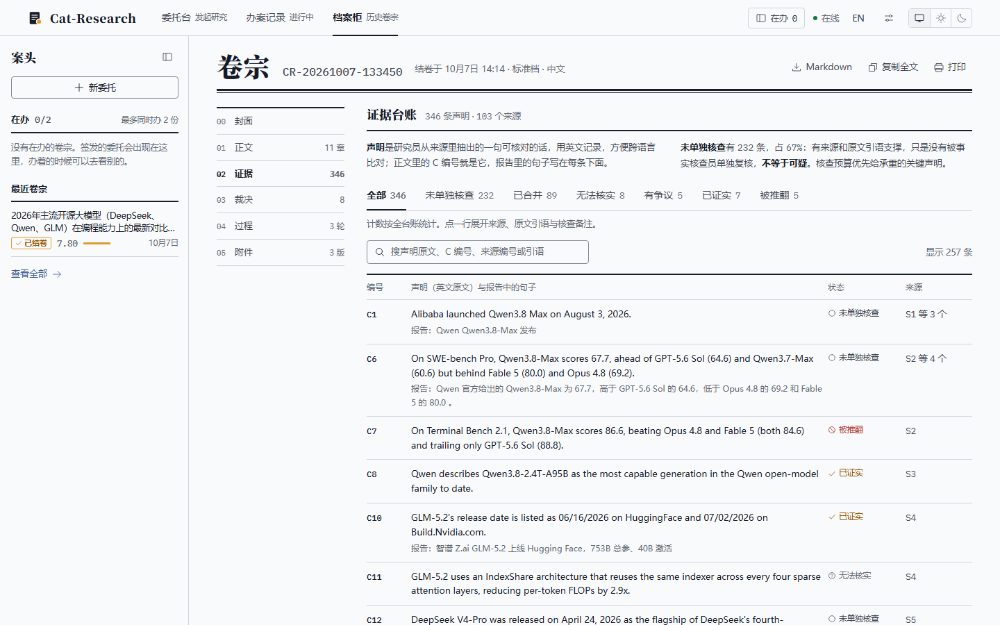
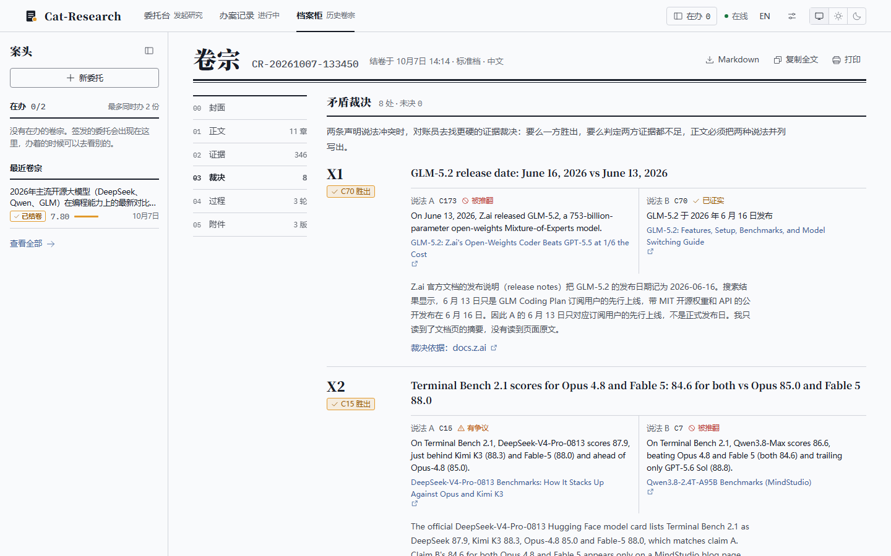

<div align="center">

# 🐱 Cat-Research

**多智能体深度研究系统：搜索、对账、核查、迭代，交付一份每句话都能追到来源的研究报告**

[](https://python.org)
[](https://fastapi.tiangolo.com)
[](LICENSE)
[](https://github.com/anthropics/claude-agent-sdk-python)

中文 · [English](README.en.md)

</div>



Cat-Research 把一个研究问题交给 10 个分工明确的智能体：先问清楚你要什么，再规划检索、联网搜索、把资料拆成带编号的声明并逐条对账，矛盾处联网裁决，写出初稿后多轮评审改写，最后交付终稿和一份置信度报告。

默认通过本机已登录的 Claude Code 调用 Claude（用订阅额度，不需要 API Key），也可以换成 OpenAI、智谱，或任意 OpenAI 兼容端点（DeepSeek、Kimi、通义、本地部署等）；联网搜索可选智谱、博查或 Tavily。

> 2026 年 3 月发布的早期版本（智谱 GLM 单提供方、单页界面）保留在 tag [`v1-glm`](https://github.com/mmlong818/Cat-Research/tree/v1-glm)。

## 和普通 AI 问答有什么不同

- **先问清楚再动手**：研究助理会追问 2–3 个关键点（对象和时间、你拿它做什么、深度），整理成一张委托单，你确认后才开始。
- **声明台账**：研究员读过的每个来源都被拆成带编号的声明（`C12`）并附原文片段；程序自动比对片段里的数字和日期，去重（含中英文同义表述），找出互相矛盾的声明对。
- **矛盾逐条裁决**：每处矛盾由事实核查员独立联网裁决——一方胜出，或判定两方证据都不足；关键数字类声明另行独立核实。
- **报告正文必须引用台账**：事实以 `[C编号]` 引用，程序逐段检查，引用了被推翻或未裁决声明的稿子不能当终稿。
- **来源分级**：Tier 1–4 + 0–100 分域名评分，低可信来源被标注并优先核查。
- **多轮评审改写**：评审员 7 项打分、结论验证员 5 项打分，两者都对照你的委托内容检查；改写基于历史最优稿（棘轮），未达标时按需补充研究。
- **研究中途可以插话**：暂停、恢复、停止，或补充一条要求，它会传给之后工作的所有智能体。
- **可追溯的卷宗**：结论、正文、证据、裁决、评分轨迹、各版草稿都能在界面里翻看和下载，并附用量与费用统计。

## 快速开始

### 环境要求

- Python 3.10+
- Node.js（用于构建 Web UI；CI 使用 22）
- 已安装并登录 [Claude Code](https://github.com/anthropics/claude-code)（使用其他提供方时不需要）
- 可以访问外网（实时搜索）

### 1. 安装

```bash
git clone https://github.com/mmlong818/Cat-Research.git
cd Cat-Research
pip install -r requirements.txt

# 构建 Web UI（产物输出到 static/，仓库里不带）
cd frontend && npm ci && npm run build && cd ..
```

### 2. 登录 Claude Code

所有智能体通过 [claude-agent-sdk](https://github.com/anthropics/claude-agent-sdk-python) 调用本机的 Claude Code，复用它的登录状态。

```bash
npm install -g @anthropic-ai/claude-code
claude auth login
```

> **Windows**：npm 安装的 `claude.CMD` 不能被 SDK 直接调用，程序会自动改用包内的
> `node_modules/@anthropic-ai/claude-code/bin/claude.exe`。找不到时，用环境变量 `CLAUDE_CLI_PATH` 指向它。

### 3. 启动

```bash
python run_api.py
# 打开 http://localhost:8000
```

默认只监听本机。局域网访问见 [配置](#配置)。

## 使用

### Web UI



| 页面 | 地址 | 做什么 |
|------|------|--------|
| **委托台** | `/new` | 用一句话说出你想弄清楚的事，研究助理追问后生成委托单；核对深度档、报告语言（中 / 英）、提供方与模型后签发 |
| **办案记录** | `/case/{任务ID}` | 实时时间线；暂停 / 恢复 / 停止；中途补充要求；改进循环到关口时递「签批单」问你是否再改一轮（5 分钟无回应自动继续） |
| **档案柜** | `/cabinet` | 历史研究列表，可筛选；从断点续办、从指定阶段重办、删除 |
| **卷宗** | `/dossier/{会话ID}` | 六个标签：封面（结论与可信度）、正文、证据（声明台账）、裁决（矛盾）、过程（评分轨迹）、附件（各版草稿下载） |

最多同时进行 2 项研究。界面支持中英文切换和浅色 / 深色 / 跟随系统主题。





### 深度档

| 深度档 | 检索条数 | 评审轮数 | 补充研究上限 | 独立核实声明 | 承重声明补核 | 参考耗时 |
|--------|---------|---------|-------------|-------------|-------------|---------|
| 速览 `quick` | 6 | 1 | 0 次 | 8 条 | 0 条 | 十几分钟 |
| 标准 `standard`（默认） | 10 | 2–3 | 2 次 | 12 条 | 3 条 | 约 40 分钟 |
| 深度 `deep` | 15 | 2–5 | 3 次 | 16 条 | 5 条 | 45–80 分钟，$15–$35 |

也可以选「自定义轮数」：检索条数同标准档，只指定最少 / 最多改进轮数。

> 实测参考（非承诺值）：2026 年 10 月一次标准档研究（"开源大模型编程能力对比"）用时 40 分钟、花费 $17.51，读过 103 个来源、抽出 346 条声明、裁决 8 处矛盾，评审 3 轮。

### 命令行

```bash
# 直接研究（标准档，不经澄清，开始前确认一次）
python main.py "2026年全球固态电池量产进展与主要厂商时间表"

# 交互模式：输入问题后最多 4 轮澄清对话（直接回车跳过），确认后开始
python main.py
```

## 模型与提供方

默认全部调用经由 `claude-agent-sdk` 转发给本机的 Claude Code：

| 角色 | 默认模型 | 负责的智能体 |
|------|----------|--------------|
| 核心模型 | `claude-opus-5-5` | Clarifier、Planner、Researcher、Analyst、Writer |
| 辅助模型 | `claude-sonnet-5-5` | Critic、SourceVerifier、Reconciler、FactChecker、ConclusionValidator |

也可以换用其他提供方，调用层按模型 ID 自动路由：

| 提供方 | 核心 / 辅助（默认） | 联网 | 结构化输出 | API Key |
|--------|--------------------|------|------------|---------|
| Claude | `claude-opus-5-5` / `claude-sonnet-5-5` | Claude Code 内置 WebSearch / WebFetch | SDK 结构化输出 + 本地校验 | 不需要 |
| OpenAI | `gpt-6.1-sol` / `gpt-6-luna` | 托管 web_search | json_schema（strict）+ 本地校验 | `OPENAI_API_KEY` |
| 智谱 | `glm-5.3` / `glm-5.3-flash` | 本地工具循环（所选搜索服务 + 本机抓取网页） | json_object + 提示词 + 本地校验 | `ZHIPU_API_KEY` |
| OpenAI 兼容 | 自填，ID 记作 `compat:<模型名>` | 本地工具循环（所选搜索服务 + 本机抓取网页） | json_object（端点不支持时退回提示词）+ 本地校验 | `COMPAT_API_KEY` |

- **在界面里选**：设置里选默认提供方及其核心、辅助模型，录入 API Key（存入系统凭据库，页面只显示末 4 位）；签发委托时可临时换提供方或指定型号，选择记入审计。缺 Key 时接口在建任务前返回 400。重放沿用会话原来的提供方与模型。
- **OpenAI 兼容端点**：在设置里填 Base URL、API Key、核心与辅助模型名，点「测试连接」确认连通且模型支持工具调用（function calling）——不支持的模型无法用于研究。这类模型不在能力表里，只统计搜索费用，不计 token 价格。
- **用环境变量或 `settings.json`**：`CORE_MODEL` / `SUPPORT_MODEL`（优先），或复制 `settings.example.json` 为 `settings.json` 后填 `core_model` / `support_model`。

### 联网搜索

Claude 与 OpenAI 用各自自带的联网能力；智谱与 OpenAI 兼容端点用设置里选的搜索服务（网页正文都在本机抓取）：

| 搜索服务 | 单价 | API Key | 说明 |
|----------|------|---------|------|
| 智谱 Search API（默认） | $0.01 / 次 | 与智谱 API Key 相同 | |
| 博查 | 约 $0.005 / 次 | `BOCHA_API_KEY` | 国内直连；单价为估算 |
| Tavily | $0.008 / 次 | `TAVILY_API_KEY` | 每月有免费额度；国内网络可能需要代理 |

## 工作原理

```
用户提问
   │
   ├─→ [1] 🗣️ Clarifier        追问关键点，生成委托单（对象、范围、用途、深度）
   ├─→ [2] 📋 Planner          生成多语言检索查询（条数按深度档）
   ├─→ [3] 🔍 Researcher       3 条一组、最多 4 组并行搜索与抓取；产出研究笔记与结构化声明（入台账）
   ├─→ [4] 🔎 SourceVerifier   来源分级（Tier 1–4 + 0–100 分）；来源质量差时补充研究
   ├─→ [5] 📒 Reconciler       声明去重 + 找出矛盾对
   │       🔬 FactChecker      逐处裁决矛盾 + 独立核实关键声明
   ├─→ [6] 🧐 Analyst          基于已裁决的台账做综合分析
   ├─→ [7] ✍️ Writer           初稿，事实以 [C编号] 引用台账
   └─→ [8] 🔄 改进循环（轮数按深度档）
           ├─ 📎 引用检查          重建「声明来源」附录，检查被推翻 / 未裁决的引用
           ├─ 🎯 Critic            7 项评分（满分 10），对照委托内容
           ├─ ✔️ ConclusionValidator 5 项评分，对照委托内容
           ├─ 🏁 停止判断          见下
           ├─ 🔍 补充研究          评审提出需求且未用完预算时；新声明随即对账、裁决
           ├─ 🔬 承重声明补核      最优稿里被引用最多、尚未核查的声明
           └─ ✍️ Writer            基于最优稿改写，参考评审意见与结论验证意见
   │
   ▼
终稿（09_final.md，无引用违规的最优稿）+ 置信度报告
```

**停止条件**（都需先满足最少轮数）：评审 ≥ 8.0 且结论验证 ≥ 7.5 且无引用违规、无未决矛盾；或连续 1 轮评审分未超过最优分；或达到最多轮数。

**置信度** = 结论有效性 × 40% + 事实准确性 × 35% + 来源质量 × 25%（缺失项剔除后归一化）；≥ 0.75 为高，≥ 0.55 为中，否则为低。

### 10 个智能体

| 智能体 | 职责 |
|--------|------|
| 🗣️ **Clarifier** | 识别意图、追问关键点，确定研究方向与深度 |
| 📋 **Planner** | 把问题分解为多语言检索查询，按时效与领域分层 |
| 🔍 **Researcher** | 用提供方自带的联网能力（或所选搜索服务）搜索与抓取网页，聚合多源资料，抽取带原文片段的声明 |
| 🔎 **SourceVerifier** | 给每个来源打 Tier 标签和 0–100 分，识别不可靠来源 |
| 📒 **Reconciler** | 比对新旧声明，合并重复，找出矛盾声明对 |
| 🔬 **FactChecker** | 逐处联网裁决矛盾，独立核实关键数字类声明，给出 0.0–1.0 置信度 |
| 🧐 **Analyst** | 整合资料，提炼关键发现，做因果、趋势、对比分析 |
| ✍️ **Writer** | 撰写结构化报告；改写时以评审意见为主、结论验证意见为补充 |
| 🎯 **Critic** | 完整性、准确性、深度、清晰度、实用性、来源、简洁 7 项打分，并检查是否满足委托与中途要求 |
| ✔️ **ConclusionValidator** | 验证结论的逻辑严密性、全面性与实用价值，并判断是否回应了委托要求 |

## 输出结构

每次研究在 `workspace/` 下生成一个会话目录：

```
workspace/session_20261007_133450/
├── 00_session.json               # 会话元信息（状态、模型、耗时、用量与费用）
├── 01_question.txt               # 研究问题与委托补充说明
├── 03_plan.json                  # 检索计划
├── 04_clarification/             # 澄清结果
├── 04_research/                  # 各轮原始搜索数据与网页内容
├── 05_analysis.md                # 综合分析
├── 06_drafts/                    # 各版草稿（draft_0.md 为初稿，末尾附「声明来源」）
├── 07_reviews/                   # 每轮评审（7 项分数）
├── 08_verification/
│   ├── ledger.json               # 声明台账（来源 S* / 声明 C* / 矛盾 X* 及裁决）
│   ├── source_verification.json  # 来源评估
│   ├── fact_check.json           # 独立核实与矛盾裁决
│   ├── conclusion_validation.json
│   ├── confidence_report.json    # 置信度报告
│   └── verified_registry.json    # 已执行查询的缓存
├── 09_final.md                   # 终稿
├── research_log.txt              # 运行日志
└── .checkpoints/                 # 每个阶段完成后的快照，用于续办与重放
```

任务状态保存在项目根的 `research_tasks.db`，服务重启后仍可查询；重启前未结束的任务标记为 `interrupted`。

## 配置

环境变量（示例见 `.env.example`；模型项优先级高于 `settings.json`）：

| 变量 | 默认值 | 说明 |
|------|--------|------|
| `CORE_MODEL` / `SUPPORT_MODEL` | `claude-opus-5-5` / `claude-sonnet-5-5` | 核心 / 辅助模型 |
| `CLAUDE_CLI_PATH` | 自动查找 | 原生 claude 可执行文件路径 |
| `OPENAI_API_KEY` / `ZHIPU_API_KEY` | — | 使用对应提供方时需要（也可在设置页录入） |
| `COMPAT_BASE_URL` / `COMPAT_API_KEY` | — | OpenAI 兼容端点（也可在设置页录入） |
| `SEARCH_BACKEND` | `zhipu` | 智谱与兼容端点用的搜索服务：`zhipu` / `bocha` / `tavily` |
| `BOCHA_API_KEY` / `TAVILY_API_KEY` | — | 选用博查 / Tavily 时需要 |
| `API_HOST` | `127.0.0.1` | 局域网访问改为 `0.0.0.0` |
| `API_PORT` | `8000` | 服务端口 |
| `CAT_ALLOWED_HOSTS` | — | 额外允许的主机名（逗号分隔），局域网访问时填写 |
| `CAT_API_AUTH` | `1` | `/api/*` 需要本地令牌；前端开发模式可设 `0` |
| `CAT_API_TOKEN` | 启动时随机生成 | 固定本地令牌 |
| `CORS_ORIGINS` | `localhost:3000`、`localhost:8000`、`127.0.0.1:8000` | 允许的跨域来源 |

> **安全**：服务启动时生成本地令牌并注入 Web UI 页面，前端自动携带，其他网站受同源策略限制读不到它；所有请求校验 Host 头（防 DNS rebinding）；界面里填的 API Key 存入系统凭据库（Windows 凭据管理器），不写明文文件。

研究参数是 `config.py` 里的常量（不读环境变量）：深度档在 `DEPTH_PRESETS`，另有

```python
QUALITY_THRESHOLD = 8.0       # 评审分达标线（满分 10）
CONCLUSION_THRESHOLD = 7.5    # 结论验证平均分达标线
NO_GAIN_PATIENCE = 1          # 连续多少轮评审分未超过最优分即停止
```

## API

启动后在 `http://localhost:8000/docs` 有完整的 Swagger 文档。主要接口：

**研究任务**

| 方法 | 端点 | 说明 |
|------|------|------|
| `POST` | `/api/research` | 启动研究（超过 2 个并发任务返回 429） |
| `GET` | `/api/research/{id}/stream` | SSE 实时进度 |
| `GET` | `/api/research/{id}/status` | 任务状态 |
| `GET` | `/api/research/{id}/result` | 任务结果（未完成返回 425） |
| `GET` | `/api/research/{id}/audit` | 审计日志：用户输入与操作、检查点、停止原因、终稿选择 |
| `POST` | `/api/research/{id}/message` | 中途补充要求 |
| `POST` | `/api/research/{id}/loop-decision` | 回答改进循环的「是否再改一轮」 |
| `POST` | `/api/research/{id}/pause` · `/resume` · `/stop` | 暂停 / 恢复 / 停止（停止发 `stopped` 事件，与失败的 `error` 分开） |
| `POST` | `/api/research/stop-all` | 停止全部任务 |
| `DELETE` | `/api/research/{id}` | 停止并删除任务（审计记录保留） |

**会话**

| 方法 | 端点 | 说明 |
|------|------|------|
| `GET` | `/api/sessions` | 历史会话列表（分页） |
| `GET` | `/api/sessions/{id}/report` | 终稿 |
| `GET` | `/api/sessions/{id}/drafts` | 各版草稿列表 |
| `GET` | `/api/sessions/{id}/drafts/{draft_id}/download` | 下载草稿（`draft_id` 为版本号或 `final`） |
| `GET` | `/api/sessions/{id}/ledger` | 声明台账与矛盾裁决 |
| `GET` | `/api/sessions/{id}/reviews` | 每轮评审：7 项分数、优点、关键问题、改进点 |
| `GET` | `/api/sessions/{id}/plan` · `/phases` · `/phase-log` | 检索计划 / 各阶段内容 / 阶段状态与起止时间 |
| `GET` | `/api/sessions/{id}/checkpoints` | 已完成阶段的检查点与默认续跑起点 |
| `POST` | `/api/sessions/{id}/replay` | 从指定阶段重放（`{"from_phase": "improve"}`，省略则从断点续跑） |
| `GET` | `/api/sessions/{id}/audit` | 会话审计日志（含所有重放任务） |
| `DELETE` | `/api/sessions/{id}` | 删除会话及工作区 |

阶段依次为 clarify → plan → research → sources → ledger → analyze → draft → improve → finish。重放时该阶段之后的草稿、评审与台账一并回滚；同一会话同时只能有一个任务。

**澄清**

| 方法 | 端点 | 说明 |
|------|------|------|
| `POST` | `/api/clarify` | 开始澄清对话 |
| `POST` | `/api/clarify/{id}/message` | 继续对话 |
| `POST` | `/api/clarify/{id}/confirm` | 确认委托并启动研究（可带改过的 `question` 与研究目标 `goal`） |

**系统**

| 方法 | 端点 | 说明 |
|------|------|------|
| `GET` | `/api/health` | 健康检查（无需令牌） |
| `GET` · `POST` | `/api/config` | 查看 / 运行时更新系统配置 |
| `GET` · `POST` | `/api/settings` | 默认配置档、各提供方 Key 状态（仅末 4 位）与可选模型 / 更新设置 |
| `DELETE` | `/api/settings/keys/{provider}` | 清除某家的 API Key（claude / openai / zhipu） |
| `GET` | `/api/models` | 能力表里的模型，按提供方分组 |

## 开发

```bash
pip install -r requirements-dev.txt

# 前端开发模式：vite 把 /api 代理到 8002
API_PORT=8002 CAT_API_AUTH=0 python run_api.py
cd frontend && npm run dev

# 检查与测试（与 CI 一致）
ruff check .
mypy
python -m unittest discover -s tests -t .
```

CI 在 Python 3.11 / 3.14 上跑 ruff、mypy 与单元测试，在 Node 22 上构建前端。

改动研究流程（提示词、核查规则、循环策略、模型）后，可以用 `tools/eval` 跑固定问题并与基线报告盲评，见 [tools/eval/README.md](tools/eval/README.md)。

### 项目结构

```
Cat-Research/
├── main.py / run_api.py      # 命令行入口 / Web 服务入口
├── orchestrator.py           # 研究编排器
├── config.py                 # 模型与研究参数（DEPTH_PRESETS 等）
├── orchestration/            # 编排器分阶段实现：base（检查点、进度事件）、phases（阶段 1–7）、improve（改进循环）、finish（终稿与报告）
├── agents/                   # 10 个智能体
├── research/                 # 纯逻辑，不调用 LLM：台账与引用检查、原文片段比对、循环策略、中途要求、置信度、检查点
├── llm/                      # 统一调用层：模型能力表、配置档、重试、schema 校验、用量；providers/ 下为 claude / anthropic / openai / zhipu
├── api/                      # FastAPI：路由、任务库、SSE 事件、本地令牌与 Host 校验
├── tools/                    # 声明核实、域名评分、查询缓存；eval/ 回归评测
├── frontend/                 # React Web UI 源码（构建到 static/）
├── build-dist/               # Windows 打包脚本（PyInstaller）
└── tests/
```

## License

[GNU GPL v3](LICENSE)。可以自由使用、修改和分发，包括商业用途；但分发修改版或基于本项目的作品时，必须同样以 GPL v3 开源并提供源代码。

Copyright (C) 2026 mmlong818
